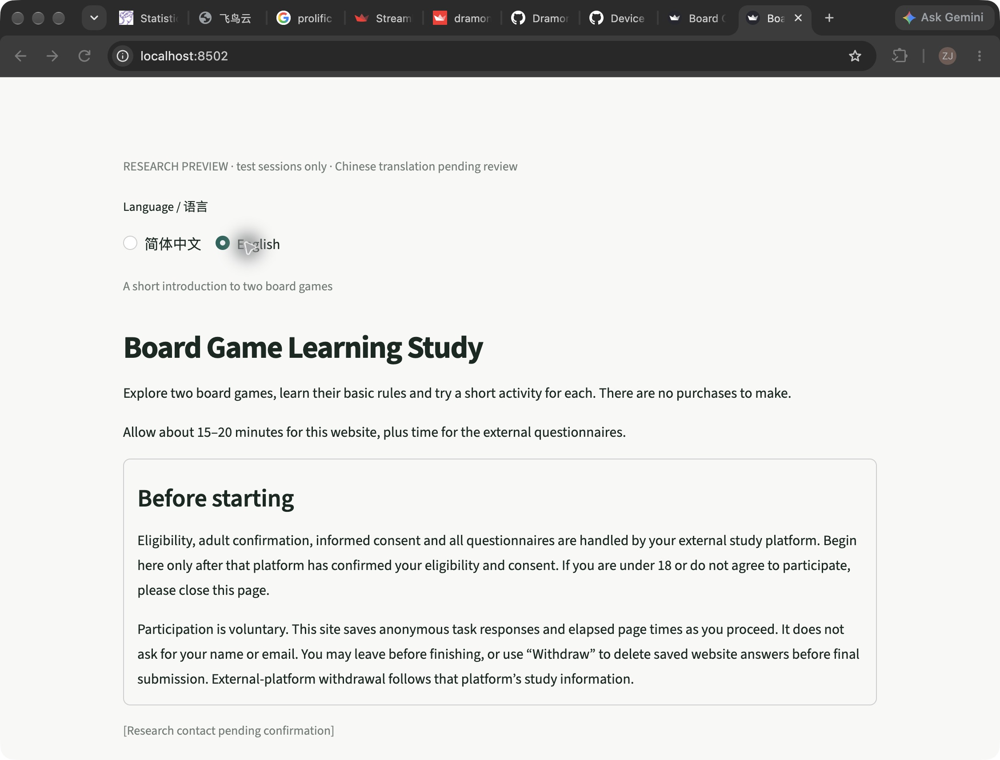
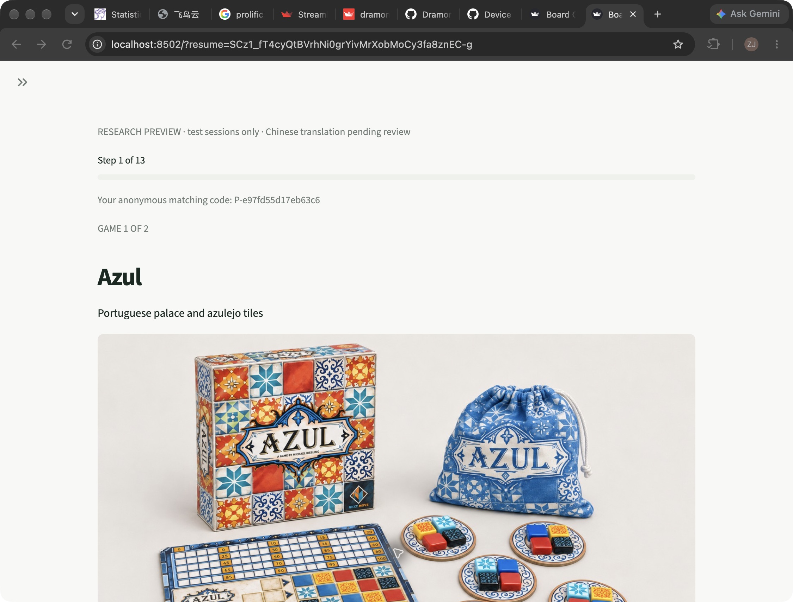
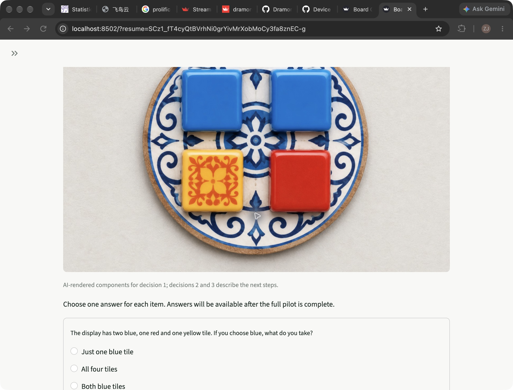
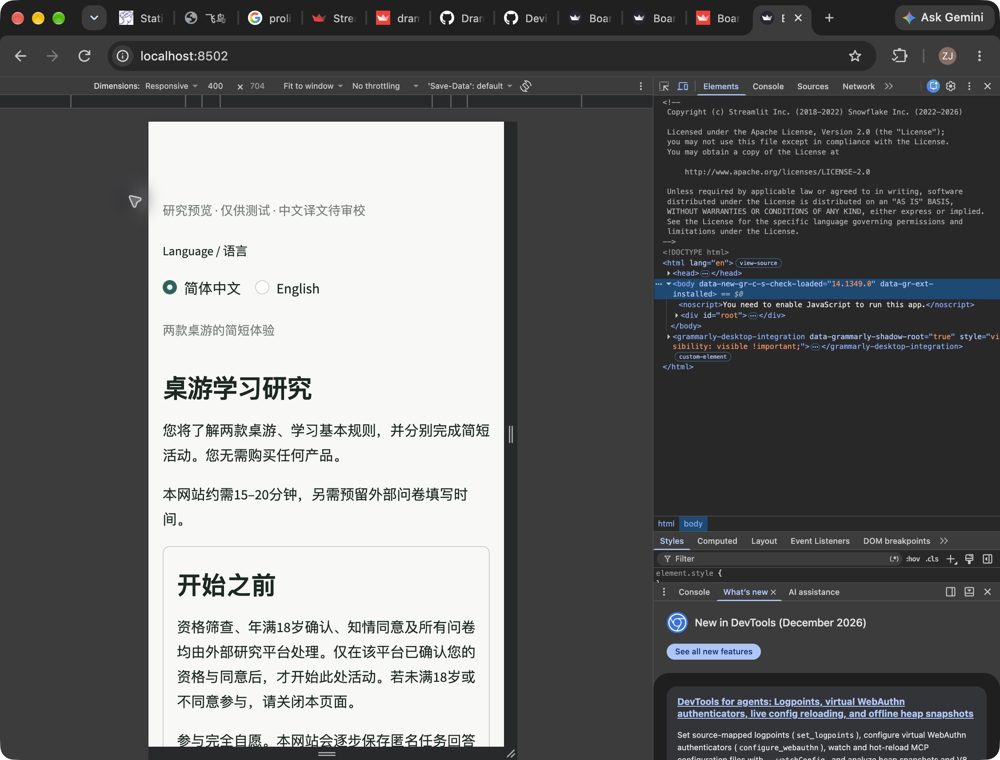
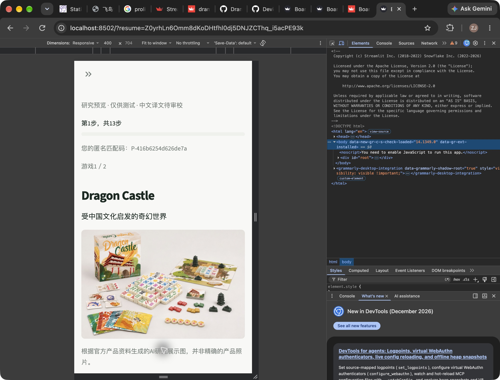
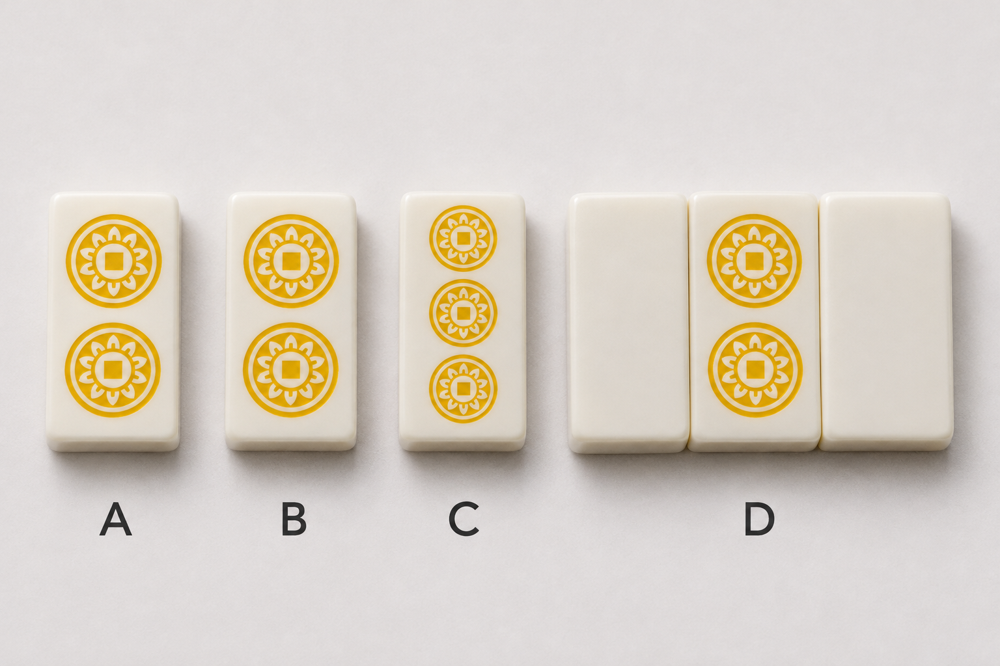
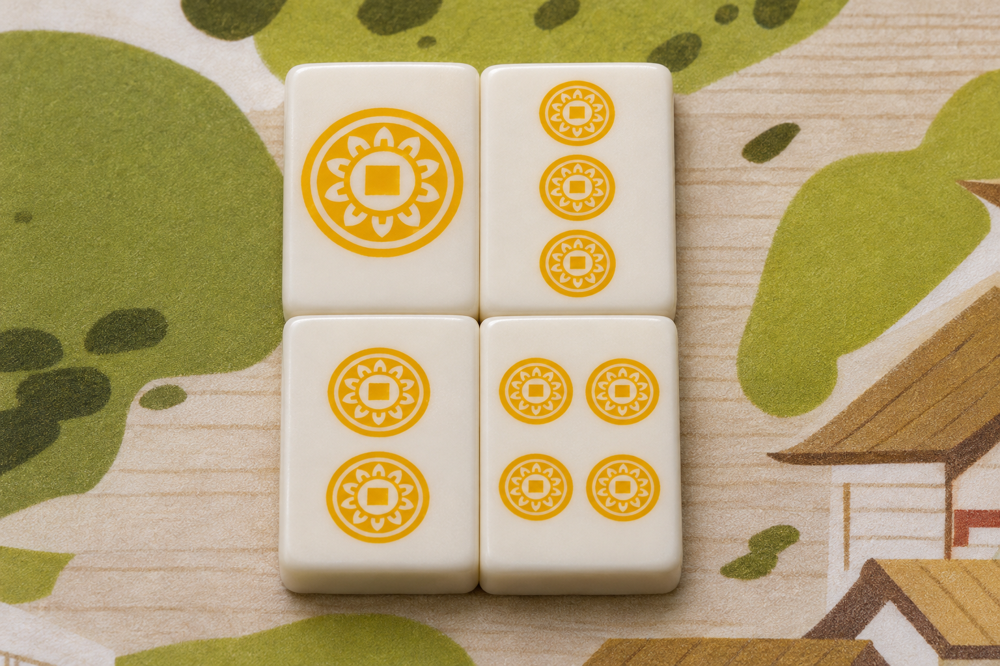
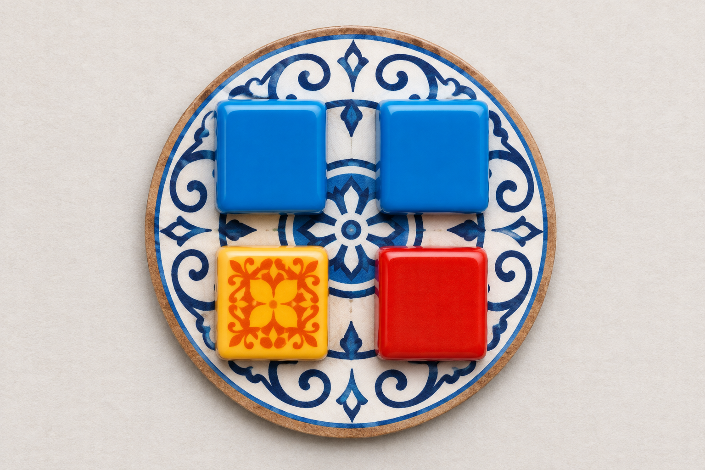
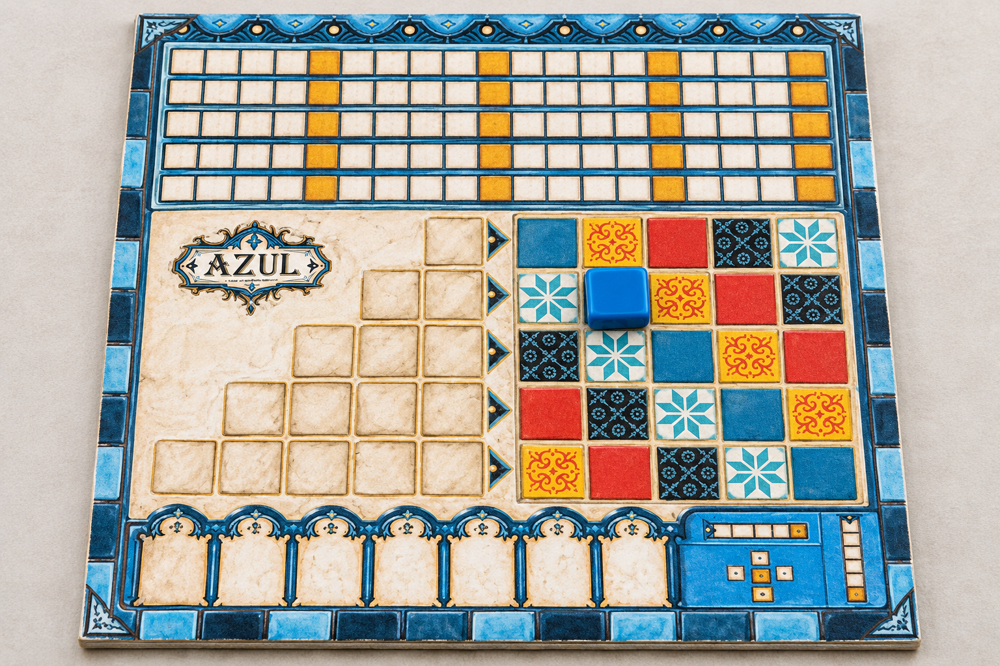

# Main participant pages

The live preview is https://phd-board-game-pilot.streamlit.app . English and Simplified Chinese are selectable before starting; the language stays fixed for the session.

| Page | What participants see and do |
| --- | --- |
| Welcome | Neutral study purpose, provisional timing, voluntary participation, external consent/eligibility boundary and language choice. |
| Product page | AI-rendered real-product overview, actual theme/components/player count/full-game duration, and a clearly marked experimental price scenario. |
| Learn | Six matched rule sections, two high-quality AI component examples, two FAQ entries and an optional official-rulebook reference panel. |
| Trial | Three required decisions using AI-rendered real-game tiles/components. No trial correctness or quiz key is displayed during the flow. |
| Quiz | Five required questions on objective, permitted actions, placement, scoring and game end. Answers are revealed after final submission only. |
| Questionnaire handoff | External-platform link with anonymous matching/game metadata, followed by a participant-reported return. Missing links have a labelled test-only preview continuation. |
| Neutral break | Three shape-counting activities with a server-enforced minimum of 90 seconds. |
| Second game | The same product/learning/trial/quiz/handoff structure in the assigned counterbalanced order. |
| Finalization and debrief | Save the website completion once, explain the pilot purpose and optionally inspect task answers and official sources. |

## Final English welcome and product page

## Final AI-rendered tile activity

All primary game-component illustrations use high-quality AI renderings based on actual product references. They are labelled renderings and require researcher fidelity review before recruitment. The official reference captures are distinguishable from generated illustrations.

## Final responsive views

## Component image detail

The selected website screenshots use expendable QA sessions. Local resume capabilities in released screenshots are invalidated before publication; no live Cloud session URL is released as a screenshot. Earlier schematic-era captures are retained only in the ignored research QA archive, not as final product-page examples.
